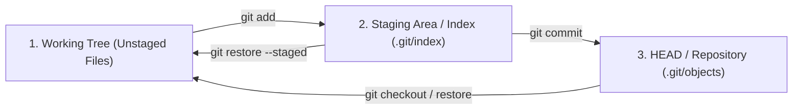

# 🐙 Git Architecture & Industrial Version Control Masterclass

[](https://git-scm.com)
[](https://conventionalcommits.org)
[](LICENSE)

> Complete zero-to-hero curriculum in Git plumbing internals, content-addressable storage, three-tree mental model, branching strategies, collaborative workflows, time travel, disaster recovery, and automated hook pipelines.

---

## 📑 Curriculum & Architecture Roadmap

```
Level 0: Setup & Three Trees ──► Level 1: Core Plumbing & Storage ──► Level 2: Branching & Merging
                                                                                   │
Level 5: Industrial Automation ◄── Level 4: Time Travel & Reflog  ◄── Level 3: Remote Collaboration
```

| Level | Topic | Description | Link |
|---|---|---|---|
| **Level 0** | **Foundations & Architecture** | Three-Tree mental model, `.git` object store, `git init`, `git config`, `.gitignore` | [`LEVEL_0_GIT_FOUNDATIONS_AND_INSTALLATION.md`](docs/LEVEL_0_GIT_FOUNDATIONS_AND_INSTALLATION.md) |
| **Level 1** | **Core Plumbing & Daily Flow** | `hash-object`, `cat-file`, blobs, trees, commits, `git add`, `git commit`, `git diff` | [`LEVEL_1_CORE_PLUMBING.md`](docs/LEVEL_1_CORE_PLUMBING.md) |
| **Level 2** | **Branching Strategies** | Fast-forward vs 3-way merge, GitFlow, GitHub Flow, Trunk-Based Development | [`LEVEL_2_BRANCHING_STRATEGIES.md`](docs/LEVEL_2_BRANCHING_STRATEGIES.md) |
| **Level 3** | **Remote Collaboration** | Remotes, tracking branches, `fetch` vs `pull`, `push --force-with-lease`, PR workflows | [`LEVEL_3_REMOTE_COLLABORATION.md`](docs/LEVEL_3_REMOTE_COLLABORATION.md) |
| **Level 4** | **Time Travel & Recovery** | `git reflog`, `reset` (--soft/mixed/hard), `git revert`, `git bisect`, `git stash` | [`LEVEL_4_TIME_TRAVEL_AND_REWRITING.md`](docs/LEVEL_4_TIME_TRAVEL_AND_REWRITING.md) |
| **Level 5** | **Industrial Git & Hooks** | Interactive rebase (`-i`), cherry-pick, submodules, worktrees, pre-commit/commit-msg | [`LEVEL_5_INDUSTRIAL_GIT_AND_AUTOMATION.md`](docs/LEVEL_5_INDUSTRIAL_GIT_AND_AUTOMATION.md) |
| **Reference** | **Command Glossary** | Complete DevOps commands cheatsheet with practical real-world flags | [`COMMAND_GLOSSARY_CHEATSHEET.md`](docs/COMMAND_GLOSSARY_CHEATSHEET.md) |
| **Playbook** | **Disaster Recovery** | Step-by-step solutions to recover deleted commits, undo pushes, and resolve conflicts | [`DISASTER_RECOVERY_PLAYBOOK.md`](docs/DISASTER_RECOVERY_PLAYBOOK.md) |
| **Exam** | **Masterclass Examination** | 24 Multiple-choice questions with deep technical explanations | [`QUIZ.md`](QUIZ.md) |

---

## 🏛️ The Three-Tree Architecture & Object Store



### Git Object Types
Every object in Git is stored under `.git/objects/<2-char-hash>/<38-char-hash>` and is compressed with zlib:
1. **Blob**: Raw binary data of file content (does NOT store file names or permissions).
2. **Tree**: Directory listing mapping blob SHA-1s and child tree SHA-1s to file names and file modes (`100644`, `100755`).
3. **Commit**: Points to a root Tree SHA-1, parent commit SHA-1(s), author/committer timestamps, and commit message.
4. **Annotated Tag**: Object pointing to a commit with tagger signature and metadata.

---

## 🛡️ Production Git Hooks Suite

This repository includes battle-tested client hooks in [`hooks/`](hooks/):

1. **[`pre-commit`](hooks/pre-commit)**:
   - Validates code against trailing whitespace.
   - Scans staged diffs for accidental leaks of AWS Access Keys, RSA/OpenSSH private keys, and plain-text passwords.
2. **[`commit-msg`](hooks/commit-msg)**:
   - Enforces Conventional Commits formatting: `<type>(<scope>): <subject>` (e.g., `feat(auth): add JWT refresh handler`).
3. **[`prepare-commit-msg`](hooks/prepare-commit-msg)**:
   - Auto-extracts ticket keys (e.g. `TC-1234`) from the active branch name and prepends them to the commit message.

To activate these hooks in your repository:
```bash
cp hooks/* .git/hooks/
chmod +x .git/hooks/*
```

---

## 🛠️ Hands-On Diagnostic & Drill Scripts

Located in [`scripts/`](scripts/):
- **[`01_git_repo_cleanup.sh`](scripts/01_git_repo_cleanup.sh)**: Removes merged feature branches, runs aggressive garbage collection (`git gc --prune=now`), and compacts packfiles.
- **[`02_simulate_merge_conflict.sh`](scripts/02_simulate_merge_conflict.sh)**: Generates an isolated sandbox repository with a real merge conflict so engineers can practice three-way conflict resolution safely.

---

## 🧪 Masterclass Examination

Evaluate your Git engineering proficiency with the 24-question test in [`QUIZ.md`](QUIZ.md). It tests low-level plumbing (`cat-file`, `hash-object`), rebase dynamics, reflog recovery, reset options, and conflict resolution mechanisms.
