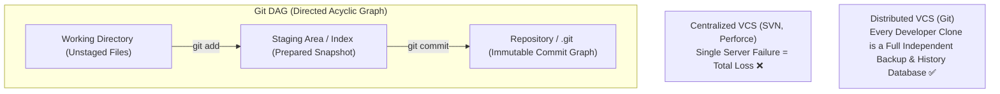

# 🐙 Level 0: Git Foundations, Cross-Platform Architecture & Installation

Welcome to the foundational entry point of the **Git Zero-to-Hero Masterclass**. Before staging changes and executing branch merges, software engineers must understand what version control fundamentally is, how Git's distributed model works, how operating system differences (Windows vs. macOS vs. Linux) impact repositories, and how to configure a pristine environment.



---

## 🏛️ 1. What is Version Control & Why Git?

Version control systems (VCS) record modifications to files over time so specific versions can be recalled, audited, and merged seamlessly.

### Centralized VCS vs. Distributed VCS (Git)
* **Centralized VCS (e.g. Subversion / SVN, TFVC, Perforce)**:
  * A single central server hosts the repository history.
  * Developers check out only working copies of files.
  * **Critical Weakness**: If the central server goes down or connectivity is lost, developers cannot commit, branch, view history, or merge. A disk crash on the server destroys the entire project history.
* **Distributed VCS (Git — Created by Linus Torvalds in 2005)**:
  * Every checkout is a **full-fidelity clone** of the repository, including every commit, branch, tag, and author signature since day one.
  * All operations (`commit`, `branch`, `diff`, `log`, `rebase`) execute locally with zero network latency.
  * If GitHub, GitLab, or the central server disappears, any team member's clone can restore the complete repository with zero loss.

### Snapshots, Not Deltas
Older VCS store changes as file-based delta diffs (Commit 2 stores "+line 4 to file.txt"). **Git does not store deltas.** Git captures an entire **snapshot of the filesystem tree** at each commit. If a file has not changed, Git does not copy it; it simply creates a lightweight cryptographic link (pointer) to the previous unchanged file blob.

---

## ⚖️ 2. Cross-Platform Operating System Gotchas: Linux vs. Windows vs. macOS

When teams collaborate across Windows, macOS, and Linux, subtle operating system differences can corrupt repositories, break build pipelines, or generate phantom git diffs.

| Cross-Platform Gotcha | 🪟 Microsoft Windows | 🍎 Apple macOS | 🐧 Linux (Production Servers) | Engineering Best Practice & Fix |
| :--- | :--- | :--- | :--- | :--- |
| **Line Endings (CRLF vs. LF)** | End-of-line is **Carriage Return + Line Feed** (`\r\n` / CRLF). | End-of-line is **Line Feed** (`\n` / LF). | End-of-line is **Line Feed** (`\n` / LF). | Windows commits CRLF into Linux servers breaking bash scripts (`^M: command not found`). Fix via `core.autocrlf` and `.gitattributes`. |
| **Filename Case Sensitivity** | **Case-Insensitive** (NTFS): `App.py` and `app.py` collide on disk. | **Case-Insensitive** by default (APFS). | **Strictly Case-Sensitive** (ext4): `App.py` and `app.py` are distinct files. | Renaming `user.js` to `User.js` on Windows/Mac won't be tracked properly. Always use `git mv old.js New.js`. |
| **Executable File Mode (`+x`)** | Windows filesystems lack POSIX `rwxr-xr-x` executable bits. | Tracks POSIX executable permissions. | Strictly enforces POSIX executable permissions. | Bash scripts (`deploy.sh`) committed from Windows lose `+x` and fail in CI/CD. Fix with `git update-index --chmod=+x deploy.sh`. |
| **File Path Length Limits** | Legacy Win32 API imposes a 260-char `MAX_PATH` limit. | 1024-character path limit. | 4096-character path limit (`PATH_MAX`). | Deeply nested npm/Java directories crash on Windows checkouts. Fix with `git config --system core.longpaths true`. |
| **Symlinks** | Requires Developer Mode or Admin rights to create symlinks. | Native Unix symlinks (`ln -s`). | Native Unix symlinks (`ln -s`). | Symlinks committed on Linux often become plain text files on Windows if `core.symlinks` is false. |
| **Credential Storage** | Windows Credential Manager (`manager` / `wincred`). | Apple Keychain Services (`osxkeychain`). | Headless `libsecret` or SSH Agent. | Store credentials securely per OS to avoid repeatedly entering tokens. |

---

## 🛠️ 3. Step-by-Step Git Installation Blueprint

Select your operating system below to install and verify the latest stable release of Git.

### 🐧 Installing on Linux

#### Ubuntu / Debian / Linux Mint:
```bash
sudo apt update
sudo apt install -y git

# Verify installation
git --version
```

#### Fedora / Red Hat / Rocky Linux:
```bash
sudo dnf install -y git

# Verify installation
git --version
```

#### Arch Linux:
```bash
sudo pacman -S git
```

---

### 🪟 Installing on Microsoft Windows

#### Method 1: Windows Package Manager (`winget` — Recommended)
Open **PowerShell** and execute:
```powershell
winget install --id Git.Git -e --source winget
```

#### Method 2: Git for Windows Official Installer
1. Download the installer from [git-scm.com/download/win](https://git-scm.com/download/win).
2. During installation wizard options, ensure you select:
   * **Default Editor**: Nano, VS Code, or your preferred editor.
   * **Default Branch**: Select **"Override the default branch name for new repositories"** and set it to `main`.
   * **PATH Environment**: Choose **"Git from the command line and also from 3rd-party software"**.
   * **Line Ending Conversions**: Choose **"Checkout Windows-style, commit Unix-style line endings"** (`core.autocrlf true`).
   * **Terminal Emulator**: Choose **"Use MinTTY (the default terminal of MSYS2)"** for Git Bash.

---

### 🍎 Installing on Apple macOS

#### Method 1: Xcode Command Line Tools (Apple Official)
Open Terminal and run:
```bash
xcode-select --install
```
A popup dialog will prompt you to install Apple's developer command-line tools, which includes `git`.

#### Method 2: Homebrew (Latest Git Release)
If you already use Homebrew:
```bash
brew install git
brew link git --overwrite
git --version
```

---

## ⚙️ 4. Mandatory First-Time Global Git Configuration

Immediately after installation, establish your engineering identity and cross-platform guardrails. These configurations are persisted globally in `~/.gitconfig`.

### 1. Identify Yourself (Required for Every Commit)
Git embeds author identity immutably into every commit hash. Set your full name and public email:
```bash
git config --global user.name "Alex Morgan"
git config --global user.email "alex@teachcloud.dev"
```

### 2. Standardize Default Branch to `main`
Replace outdated `master` naming with industry-standard `main`:
```bash
git config --global init.defaultBranch main
```

### 3. Configure Cross-Platform Line Endings
* **On Windows**:
  ```bash
  git config --global core.autocrlf true
  ```
* **On macOS & Linux**:
  ```bash
  git config --global core.autocrlf input
  ```

### 4. Configure Pull Strategy (Avoid Unintentional Merge Bubbles)
Enforce fast-forward or rebase merges when pulling remote changes:
```bash
git config --global pull.rebase true
```

### 5. Set Your Preferred Terminal Editor
```bash
git config --global core.editor "nano"
# Or VS Code:
# git config --global core.editor "code --wait"
```

### 6. Verify Active Configuration
Inspect your merged configuration cascade and source file locations:
```bash
git config --list --show-origin
```

---

## 🔐 5. Cryptographic SSH Key Setup (GitHub / GitLab)

Modern code hosting platforms (GitHub, GitLab, Bitbucket) have permanently deprecated plain passwords. Secure communication requires Ed25519 elliptic-curve public-key cryptography.

### Step 1: Generate an Ed25519 Key Pair
```bash
ssh-keygen -t ed25519 -C "alex@teachcloud.dev"
```
* Press `Enter` to accept the default file location (`~/.ssh/id_ed25519`).
* Enter a secure passphrase (recommended) or press `Enter` for no passphrase.

### Step 2: Start the SSH Agent & Register Key
```bash
# On Linux/macOS:
eval "$(ssh-agent -s)"
ssh-add ~/.ssh/id_ed25519

# On Windows (Git Bash):
eval $(ssh-agent -s)
ssh-add ~/.ssh/id_ed25519
```

### Step 3: Copy Your Public Key
Print your public key to the terminal:
```bash
cat ~/.ssh/id_ed25519.pub
```
Copy the output starting with `ssh-ed25519 AAAAC3...`.

### Step 4: Add Public Key to Remote Platform
* Go to **GitHub** → Settings → **SSH and GPG Keys** → **New SSH Key**.
* Paste your public key and save.

### Step 5: Test Cryptographic Handshake
```bash
ssh -T git@github.com
```
A successful handshake outputs:
```
Hi AlexMorgan! You've successfully authenticated, but GitHub does not provide shell access.
```

---

Now that Git is installed, cross-platform conventions are protected, and SSH keys are active, proceed to [`docs/Git/LEVEL_1_CORE_PLUMBING.md`](LEVEL_1_CORE_PLUMBING.md) to master commits, hunks, and the Three Trees!
