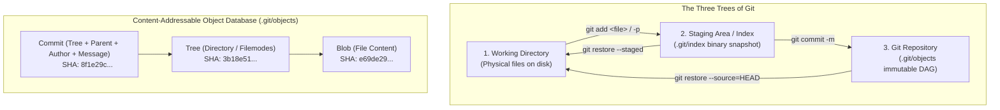

# 🎯 Level 1: Git Core Mental Model & Everyday Plumbing

Welcome to **Level 1 of the Git Zero-to-Hero Masterclass**. In this level, software engineers and DevOps practitioners transition from viewing Git as a collection of arbitrary commands to understanding its elegant internal mental model: **the Directed Acyclic Graph (DAG)**, **the Content-Addressable Storage Engine**, and **the Three Trees of Git**.



---

## 🏛️ Lesson 1.1 — The Git Architecture & Mental Model

### 1. Distributed VCS vs. Centralized VCS (SVN / Perforce)
In traditional centralized systems (Subversion, Perforce, TFVC), there is one central server hosting the master version database. If a developer is offline, commits cannot be created. If the central database is corrupted, the team loses its entire audit trail.

In Git, **every clone is a complete, self-contained database**. Every developer has the entire commit history, all branches, all tags, and the complete cryptographic object database on their local machine. Commits, branch creation, history inspection, and diffs require **zero network access** and execute in sub-milliseconds.

### 2. The Content-Addressable Storage Engine
Under the hood, Git is not a file tracking system; it is a **content-addressable key-value object database** located in `.git/objects/`. Every object is identified by the cryptographic hash of its payload (traditionally SHA-1, modernly SHA-256).

Git organizes all repository states using four fundamental object types:

| Object Type | What It Stores | How It Works | Analogy |
| :--- | :--- | :--- | :--- |
| **Blob** (Binary Large Object) | File contents only. | Does not store filename, timestamps, or permissions (`rwxr-xr-x`). If two files across different folders have identical bytes, Git stores only **one** blob. | The raw text or binary payload. |
| **Tree** | Directories, filenames, and permissions. | Contains a list of entries pointing to Blobs (files) or other Trees (subdirectories), along with their POSIX filemode (`100644` for regular, `100755` for executable, `040000` for subdirectory). | A directory folder index. |
| **Commit** | Point-in-time project snapshot metadata. | Points to a top-level Tree object, zero or more Parent commit hashes, author identity, committer identity, timestamps, and commit message. | A sealed, signed ledger entry. |
| **Annotated Tag** | Permanent release marker. | Points directly to a specific commit hash with a tagger message and optional cryptographic GPG signature. | A notarized certificate. |

### 3. Cryptographic Hashes & The Append-Only DAG
Git histories form a **Directed Acyclic Graph (DAG)**:
* **Directed**: Every commit points backward to its parent commit(s).
* **Acyclic**: The links can never loop back on themselves.
* **Immutable & Append-Only**: Because each commit hash incorporates the parent commit's hash, altering a commit from 2 years ago changes its hash, which changes every subsequent child commit's hash. This makes Git repositories mathematically tamper-evident.

### 4. Global and Local Configuration
Before authoring commits, developers configure their identity and cross-platform behavior:

```bash
# 1. Author Identity (recorded into every commit object)
git config --global user.name "Cloud Engineer"
git config --global user.email "engineer@teachcloud.dev"

# 2. Industry-standard default branch name for new repositories
git config --global init.defaultBranch main

# 3. Default CLI editor for commit messages and rebase interactive screens
git config --global core.editor "nano"

# 4. Cross-platform newline translation (prevent CRLF pollution)
git config --global core.autocrlf input

# 5. Audit all configuration sources and file origins
git config --list --show-origin
```

---

## 📦 Lesson 1.2 — The Three Trees of Git

Git manages files through three distinct states and physical areas:

```
+------------------------+      git add       +------------------------+     git commit     +------------------------+
|   Working Directory    | -----------------> |   Staging Area (Index) | -----------------> |  Repository Database   |
| (Files on local disk)  |                    | (.git/index cache)     |                    |  (.git/objects DAG)    |
+------------------------+ <----------------- +------------------------+ <----------------- +------------------------+
                                git restore                               git restore --source=HEAD
```

### 1. Working Directory (Working Tree)
The actual physical files and directories on your local drive that you view in VS Code, PyCharm, or nano. This is your sandbox. Changes made here are completely untracked until staged.

### 2. Staging Area (Index)
A binary file located at `.git/index`. It acts as a **cache or staging ground** representing the exact snapshot of files that will be included in the very next commit. Staging lets you craft precise, logical, atomic commits without committing all modified files at once.

### 3. Git Repository (`.git/`)
The permanent history database. Once changes are committed, they are stored as immutable objects inside `.git/objects/`, referenced by movable branch pointers in `refs/heads/`.

### Inspecting Repository Health & Status
```bash
# Initialize a new local repository
git init my-app

# Inspect status in full verbose format
git status

# Inspect status in short machine-readable format
git status -s
```

#### Understanding `git status -s` Two-Letter Status Codes:
The short status output uses two characters: `XY <file>`
* **Column 1 (`X`)**: Staging Area (Index) status relative to `HEAD`.
* **Column 2 (`Y`)**: Working Directory status relative to the Staging Area.

| Status Code | Meaning |
| :--- | :--- |
| `?? app.py` | Untracked file (exists in Working Directory, never staged). |
| `A  app.py` | Newly added file, staged in Index, ready to commit. |
| `M  app.py` | File modified and staged in Index. |
| ` M app.py` | File modified in Working Directory, but **NOT** staged in Index. |
| `MM app.py` | File modified, staged, and then modified **again** in Working Directory. |
| `D  app.py` | File deleted and deletion is staged. |

---

## 📝 Lesson 1.3 — Staging, Hunks & Atomic Commits

### 1. Staging Strategies
Engineers should never blindly run `git add .` without reviewing what is being staged.

```bash
# Stage a specific individual file
git add file.py

# Stage all tracked and untracked changes in current folder
git add .

# Interactive Patch Mode: Stage partial file changes (hunk by hunk)
git add -p file.py
```

#### Interactive Patch Mode Commands (`git add -p`):
When Git encounters modifications, it splits the file into contextual "hunks" and prompts:
* `y`: Stage this hunk for commit.
* `n`: Do not stage this hunk.
* `s`: Split current hunk into smaller distinct hunks.
* `e`: Manually edit the hunk in your CLI editor.
* `q`: Quit interactive staging; keep already staged hunks.

### 2. Authoring Atomic Commits & Conventional Commit Messages
An **atomic commit** represents a single, complete logical unit of work. It should compile, pass all unit tests, and contain only related changes. If a feature touches authentication and database migrations, they should be two distinct atomic commits.

#### The Conventional Commits Standard:
Format: `<type>(<scope>): <short description>`
* `feat(auth)`: A new feature for the user or system.
* `fix(payment)`: A bug fix in production logic.
* `docs(readme)`: Documentation-only changes.
* `refactor(api)`: Code refactoring without behavioral changes.
* `test(user)`: Adding or fixing automated tests.
* `chore(deps)`: Maintenance tasks, dependency bumps, or tooling config.

```bash
# Create an atomic commit with Conventional Commits format
git commit -m "feat(auth): implement argon2 password hashing"

# Amend the most recent commit (fix message or add forgotten staged files)
git commit --amend
```

### 3. Excluding Files with `.gitignore`
Sensitive files, temporary build artifacts, and dependencies must never be committed. Create a `.gitignore` file in your repository root:

```gitignore
# Wildcards: ignore all log files
*.log
*.sqlite3

# Directory patterns: ignore dependency and virtualenv folders
node_modules/
.venv/
__pycache__/
dist/
build/

# Ignore sensitive secrets
.env
*.pem
credentials.json

# Exception rule: do NOT ignore this specific important log
!important.log
```

---

## 🔍 Lesson 1.4 — Inspecting History & Code Differences

### 1. Navigating History Cleanly
A high-volume production repository requires disciplined log filtering:

```bash
# Clean one-line summary of recent commits
git log --oneline -n 10

# Visual ASCII tree graph displaying branch diverges and merges
git log --graph --oneline --decorate --all

# Show patch diff of the last 2 commits
git log --patch -2

# Filter commits by author and timestamp
git log --author="Alex" --since="2 weeks ago"

# File-change statistics (insertions and deletions per file)
git log --stat -n 5
```

### 2. Comparing Code Differences with `git diff`
`git diff` inspects changes across the Three Trees:

```bash
# 1. Compare Working Directory vs. Staging Area (Unstaged changes)
git diff

# 2. Compare Staging Area vs. Last Commit / HEAD (What will be committed next)
git diff --staged

# 3. Compare two specific commits or branches
git diff main..feature-auth

# 4. Inspect metadata and diff patch of any specific commit
git show 8f1e29c
```

---

## 💡 Level 1 Command Cheat Sheet Summary

| Command | Action Performed | When to Use |
| :--- | :--- | :--- |
| `git init <name>` | Initializes a new repository with `.git/` database. | Starting a new project from scratch. |
| `git status -s` | Summarizes working tree and index status in two-letter format. | Frequent status checks before staging. |
| `git add -p` | Interactively stages individual hunks of code. | Separating unrelated changes into clean commits. |
| `git commit -m "..."` | Records staged snapshot into the permanent commit DAG. | Finalizing an atomic unit of work. |
| `git commit --amend` | Replaces the last commit with new staged changes or message. | Fixing a typo right after committing. |
| `git diff` | Shows differences between working directory and index. | Reviewing changes before running `git add`. |
| `git diff --staged` | Shows differences between index and HEAD commit. | Final sanity check before running `git commit`. |
| `git log --graph --oneline` | Renders visual DAG branch history in single lines. | Visualizing repository divergence and merges. |
