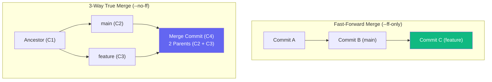
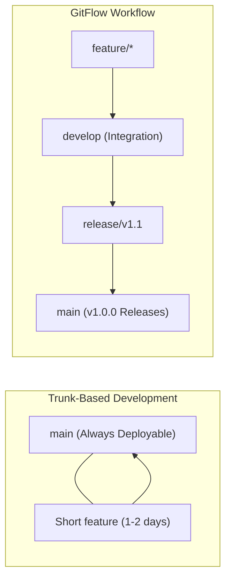

# 🌿 Level 2: Branching Strategies, Merging & Conflict Resolution

Welcome to **Level 2 of the Git Zero-to-Hero Masterclass**. In this level, engineers master how branch pointers operate under the hood, how Git calculates common ancestors for 3-way merges vs fast-forwards, how to dissect and resolve merge conflict markers, and how production engineering teams organize workflows using Trunk-Based Development, GitHub Flow, and GitFlow.



---

## 🌿 Lesson 2.1 — Branch Mechanics & Pointer Architecture

### 1. What is a Git Branch?
In many legacy VCS systems (such as SVN), creating a branch creates an entire duplicate copy of every directory and file in the project.

In Git, **a branch is not a directory copy**. A branch is simply a **lightweight, movable 41-byte pointer** that references a 40-character commit SHA hash. Because branches are just pointers:
* Creating a branch takes **1 millisecond**.
* Deleting a branch takes **1 millisecond**.
* Repositories can have thousands of branches without consuming disk space.

### 2. The `HEAD` Pointer
The special `HEAD` pointer tracks the currently checked-out branch or commit in your working directory.
* When on `main`, `HEAD` -> `refs/heads/main` -> `commit 8f1e29c`.
* When you create a new commit, `main` advances forward to the new commit SHA, and `HEAD` moves with it.
* **Detached HEAD**: If you check out a specific commit hash rather than a branch name, `HEAD` points directly to that commit rather than a branch reference.

### 3. Modern Branch Management Commands
Git introduced `git switch` in version 2.23 to separate branch switching from file restoration (`git checkout` was previously overloaded with both duties):

```bash
# 1. List all local branches (* indicates currently active branch)
git branch

# 2. List all local and remote-tracking branches
git branch -a

# 3. Create a new branch without switching to it
git branch feature-auth

# 4. Modern branch switching (replaces git checkout <branch>)
git switch feature-auth

# 5. Create and switch to a new branch in one atomic step (replaces git checkout -b)
git switch -c feature-api

# 6. Safely delete a branch (Git verifies if all commits are merged into upstream/main)
git branch -d feature-api

# 7. Force-delete an unmerged branch (discards branch pointer; commits remain in reflog)
git branch -D feature-api

# 8. Rename current branch
git branch -m feature-v2
```

---

## 🔀 Lesson 2.2 — Fast-Forward vs. True Merge Commits

When integrating two branches, Git chooses between a **Fast-Forward merge** or a **3-Way True Merge** based on the repository graph topology.

### 1. Fast-Forward Merge (`--ff` / `--ff-only`)
A fast-forward merge occurs when the target branch (`main`) has **no new commits** since the feature branch diverged:
* Git simply slides the `main` pointer forward to match the tip of the feature branch.
* No new commit object is created.
* History remains completely linear.

```bash
# Force Fast-Forward only: aborts with an error if true merge commit is required
git switch main
git merge --ff-only feature-payment
```

### 2. 3-Way True Merge Commits (`--no-ff`)
When the target branch (`main`) has progressed and has new commits that the feature branch does not have, the histories have **diverged**:
* Git identifies the **merge base** (the most recent common ancestor commit).
* Git compares the common ancestor against the tip of `main` and the tip of the feature branch.
* Git creates a brand new **Merge Commit** with **two parent commit pointers** (`Parent 1: main`, `Parent 2: feature`).

```bash
# Force explicit 3-way merge commit even if fast-forward is possible:
git switch main
git merge --no-ff feature-auth -m "merge: integrate feature-auth"
```

> **Production Tip**: Many enterprise teams enforce `git merge --no-ff` (or GitHub/GitLab PR merges) so that feature branches remain clearly grouped and identifiable as single units in the commit audit journal.

---

## ⚡ Lesson 2.3 — Anatomical Merge Conflict Resolution

### 1. What Causes a Merge Conflict?
A merge conflict occurs when two branches make **different modifications to the exact same line(s) of a file**, or when one branch deletes a file that another branch edits.

When Git cannot mathematically resolve the conflict automatically, it:
1. Pauses the merge operation.
2. Leaves your working directory in an unmerged state.
3. Injects **conflict markers** directly into the conflicting files.

### 2. Anatomy of Conflict Markers
```diff
<<<<<<< HEAD (Current Checked-Out Branch: main)
DATABASE_URL = "postgresql://prod-db:5432/teachcloud"
TIMEOUT_SECONDS = 30
=======
DATABASE_URL = "postgresql://cluster-primary:5432/teachcloud"
TIMEOUT_SECONDS = 60
>>>>>>> feature/database-refactor (Incoming Branch)
```

* `<<<<<<< HEAD`: Marks the start of changes from your active branch.
* `=======`: The divider separating the conflicting changes.
* `>>>>>>> <branch-name>`: Marks the end of changes from the incoming branch.

### 3. Step-by-Step Conflict Resolution Workflow
```bash
# Step 1: Identify all unmerged conflicting files
git status

# Step 2: Open the conflicting files in your editor.
# Review both sides, select the correct production logic, and remove all <<<<<<<, =======, >>>>>>> markers.

# Step 3: Stage the resolved files into the Index (signals to Git that conflict is resolved)
git add settings.py

# Step 4: Finalize the merge and commit the resolution
git merge --continue

# Emergency Safety Net: Abort the merge at ANY point to restore pre-merge state
git merge --abort
```

---

## 🏭 Lesson 2.4 — Production Team Branching Models

High-velocity engineering teams avoid chaotic commit histories by adhering to standard branching models.



### 1. Trunk-Based Development (Modern Cloud / DevOps Standard)
* Developers collaborate on a single branch (`main` / "trunk").
* Feature branches are extremely short-lived (typically 24–48 hours).
* Frequent merges to `main` prevent monolithic merge conflicts.
* Features in progress are hidden behind **Feature Flags** (toggles) in code.
* Ideal for: Continuous Integration & Continuous Deployment (CI/CD) teams with automated test suites.

### 2. GitHub Flow (Lightweight PR-Driven Model)
* Rule 1: Anything on `main` is always deployable to production.
* Rule 2: To work on something new, create a descriptive branch off `main` (`feature/auth-rate-limiting`).
* Rule 3: Push commits to GitHub and open a **Pull Request (PR)** early for team review.
* Rule 4: Once peer review passes and CI tests turn green, merge into `main` and deploy immediately.

### 3. GitFlow (Legacy Multi-Branch Enterprise Standard)
* `main`: Reflects production-ready state only; tagged with release numbers (`v1.0.0`).
* `develop`: Integration branch for features heading into the next release.
* `feature/*`: Branched off `develop`, merged back into `develop`.
* `release/*`: Branched off `develop` to stabilize a release (bug fixes only), merged into both `main` and `develop`.
* `hotfix/*`: Emergency patches branched directly off `main` for production fires, merged into both `main` and `develop`.

---

## 💡 Level 2 Command Quick Reference

| Command | Action Performed | Production Context |
| :--- | :--- | :--- |
| `git branch -a` | Lists all local and remote branches. | Checking active branch and remote pointers. |
| `git switch -c <name>` | Creates and checkouts new branch in one step. | Starting a new isolated feature ticket. |
| `git merge --no-ff <name>` | Forces explicit merge commit with 2 parents. | Preserving feature group identity in PRs. |
| `git merge --ff-only <name>` | Fast-forwards pointer without merge commit. | Maintaining strictly linear master history. |
| `git merge --abort` | Cancels conflicting merge and resets working tree. | Safe panic button when conflicts are messy. |
| `git merge --continue` | Concludes merge after staging resolved files. | Finalizing conflict resolution. |
| `git branch -d <name>` | Safely deletes merged branch. | Cleaning up local branch clutter after PR merge. |
| `git branch -D <name>` | Force-deletes unmerged branch. | Discarding abandoned feature experiments. |
