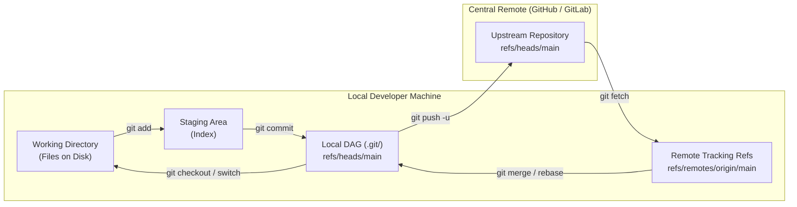

# 🌐 Level 3: Remote Collaboration, Syncing & Cryptographic Auth

Welcome to **Level 3 of the Git Zero-to-Hero Masterclass**. In this level, engineers master how local Git repositories communicate with remote distributed servers (such as GitHub, GitLab, and AWS CodeCommit), how remote-tracking branches decouple downloads from merges, how to synchronize histories linearly with rebase pulls and safe force-pushes, and how to configure cryptographic commit signing with SSH and GPG.



---

## 🌐 Lesson 3.1 — Remotes Architecture & Linkage

### 1. What is a Git Remote?
In Git's distributed architecture, there is no inherent "master" server hardcoded into the engine. Every clone is a fully functional, self-contained Git repository containing the complete project history. 

A **remote** is simply a named shortcut alias pointing to a URL of another repository. By convention, the primary upstream repository is named `origin`.

### 2. Remote Protocols: SSH vs HTTPS
| Protocol | Example URL | Authentication Mechanism | Best For |
| :--- | :--- | :--- | :--- |
| **SSH** | `git@github.com:teachcloud/cloud_flask.git` | Public/Private Keypair (`~/.ssh/id_ed25519`) | Production developers, CI/CD runners, and headless servers |
| **HTTPS** | `https://github.com/teachcloud/cloud_flask.git` | Personal Access Tokens (PAT) / OAuth Credential Helper | Firewalled corporate proxies blocking port 22 |

### 3. Remote Configuration & Linkage Commands
```bash
# 1. Inspect existing remotes with verbose URLs (fetch and push targets)
git remote -v

# 2. Add a new remote named 'origin' using SSH protocol
git remote add origin git@github.com:teachcloud/cloud_flask.git

# 3. Add a second remote pointing to the canonical open-source upstream
git remote add upstream git@github.com:original-author/cloud_flask.git

# 4. Rename a remote alias (e.g., origin -> upstream)
git remote rename origin upstream

# 5. Remove an outdated or decommissioned remote
git remote remove old-remote

# 6. Inspect detailed remote branch configurations and stale tracking refs
git remote show origin
```

---

## 🔄 Lesson 3.2 — Fetching vs Pulling & Branch Tracking

### 1. The Critical Distinction: `git fetch` vs `git pull`
Understanding the separation between fetching and pulling is the hallmark of a senior version control practitioner.

* **`git fetch` (Safe & Non-Destructive)**:
  * Downloads all new commits, branches, and tags from the remote server into your local `.git` repository database.
  * Updates **remote-tracking branches** (`refs/remotes/origin/*`).
  * **Never modifies your working directory** or changes your currently checked-out branch. You can fetch at any time without fear of conflicts or losing uncommitted changes.

* **`git pull` (Compound Command)**:
  * Executes `git fetch` to download latest remote objects.
  * Followed immediately by `git merge FETCH_HEAD` into your active branch.
  * If both you and a colleague committed independently, `git pull` creates an automatic merge commit ("Merge branch 'main' of github.com..."), cluttering the commit graph with unnecessary merge bubbles.

### 2. The Rebase-Pull Strategy
To maintain a clean, linear DAG history without redundant merge bubbles, configure Git to rebase local commits on top of incoming upstream commits:

```bash
# Fetch and replay your local commits on top of origin/main
git pull --rebase origin main

# Enforce rebase-pull globally as the default for all future git pull commands
git config --global pull.rebase true

# Autostash unstaged local changes before rebasing and restore them after
git config --global rebase.autoStash true
```

### 3. Pruning Stale Remote Tracking Branches
When colleagues merge Pull Requests and delete their feature branches on GitHub, your local repository retains stale remote-tracking pointers (`origin/feature-xyz`). Use `--prune` to sweep away ghost pointers:

```bash
# Sweep local database and remove tracking refs deleted on remote
git fetch --prune origin

# Automatically prune stale branches on every fetch/pull globally
git config --global fetch.prune true
```

---

## 🚀 Lesson 3.3 — Pushing & Tracking Branches

### 1. Setting Upstream Tracking
When pushing a newly created local branch for the first time, establish upstream tracking using the `-u` (or `--set-upstream`) flag:

```bash
# Push branch and configure local 'feature-billing' to track 'origin/feature-billing'
git push -u origin feature-billing

# Once upstream is linked, subsequent updates require only:
git push
git pull
```

### 2. Inspecting Branch Tracking Status with `git branch -vv`
To audit all tracking relationships across the repository, use verbose branch inspection:

```bash
git branch -vv
```
Example Output:
```text
* main            8f1e29c [origin/main] feat(auth): implement argon2 password hashing
  feature-billing a1d9834 [origin/feature-billing: ahead 2, behind 1] feat(stripe): webhook
  hotfix-cors     32f8190 [origin/hotfix-cors: ahead 1] fix(api): allow preflight
```
* **ahead 2**: You have 2 local commits not yet pushed to the remote.
* **behind 1**: A teammate pushed 1 commit to the remote that you have not pulled yet.

### 3. Safe Force-Pushing: Preventing Team Destruction
When interactive rebase (`git rebase -i`) or commit amending (`git commit --amend`) rewrites local history, Git will reject a standard `git push` because the commit SHAs have diverged.

> [!CAUTION]
> **NEVER use `git push --force` (`-f`) in production teams!**
> `git push --force` unconditionally overwrites the remote branch. If a teammate pushed commits while you were rebasing, `--force` will permanently wipe their work from the remote branch.

**ALWAYS use `--force-with-lease`**:
```bash
# Atomic safety check: only overwrites remote if nobody else pushed in the interim
git push --force-with-lease origin feature-billing
```
`--force-with-lease` checks if your local remote-tracking ref (`origin/feature-billing`) matches the actual commit tip on the remote server. If a colleague pushed new commits, the push aborts safely with a rejection notice.

### 4. Deleting Remote Branches
Once a feature branch is merged into `main` via PR, remove the remote branch tip:
```bash
# Delete remote branch on GitHub
git push origin --delete feature-billing
```

---

## 🔐 Lesson 3.4 — Cryptographic Authentication & Commit Signing

### 1. SSH Authentication Setup
Modern cloud platforms (GitHub, GitLab, Bitbucket) mandate asymmetric SSH keypairs for CLI authentication. Ed25519 (Edwards-curve Digital Signature Algorithm) is the current industry standard for maximum cryptographic security and speed.

```bash
# 1. Generate an Ed25519 SSH Keypair with email identifier
ssh-keygen -t ed25519 -C "dev@teachcloud.dev"

# 2. Start SSH agent in background and load private key
eval "$(ssh-agent -s)"
ssh-add ~/.ssh/id_ed25519

# 3. Print public key to copy into GitHub Settings -> SSH and GPG keys
cat ~/.ssh/id_ed25519.pub

# 4. Test SSH handshake connection to GitHub
ssh -T git@github.com
```

### 2. Verified Commits via SSH Signing
Git 2.34+ allows using your existing SSH key to cryptographically sign commits—eliminating the complexity of legacy GPG keyrings.

```bash
# 1. Instruct Git to use SSH format for signing
git config --global gpg.format ssh

# 2. Set your SSH public key as the signing key
git config --global user.signingkey ~/.ssh/id_ed25519.pub

# 3. Enable automatic commit signing by default
git config --global commit.gpgsign true

# 4. Enable automatic tag signing by default
git config --global tag.gpgSign true
```

### 3. Verifying Cryptographic Signatures
Signed commits appear with a green **"Verified"** badge on GitHub and GitLab, guaranteeing that the author identity has not been spoofed:

```bash
# Audit cryptographic signature on the most recent commit
git log --show-signature -n 1
```
Example Output:
```text
commit 8f1e29c3d4e821b9a5101eb658d8af03e9c08fb (HEAD -> main)
Good "ssh" signature for dev@teachcloud.dev with ED25519 key SHA256:4t7a1kX+...
Author: Cloud Engineer <dev@teachcloud.dev>
Date:   Tue Oct 20 17:15:00 2026 +0100

    feat(auth): implement argon2 password hashing with PKCE validation
```

---

## 📝 Level 3 Summary & Key Takeaways

1. **Remotes are Named Aliases**: `origin` is simply a convention pointing to your remote URL.
2. **`fetch` Downloads, `pull` Merges**: Always fetch before merging or reviewing teammate branches.
3. **Keep History Linear**: Configure `pull.rebase true` to eliminate unnecessary merge bubbles.
4. **Never Blindly Force-Push**: Use `--force-with-lease` to protect colleagues' commits during rebased feature branch updates.
5. **Cryptographic Identity**: Sign all commits using Ed25519 SSH keys (`commit.gpgsign true`) for supply-chain integrity and GitHub "Verified" status.
