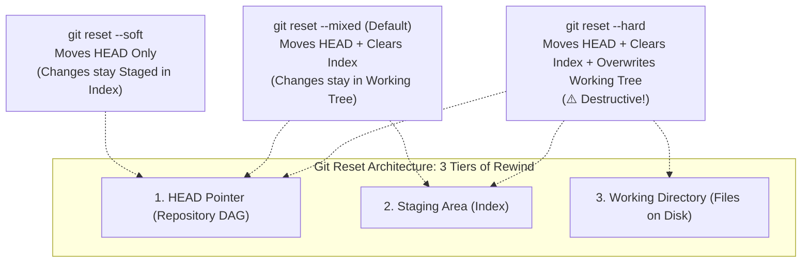

# ⏳ Level 4: Time Travel, Undoing Changes & History Rewriting

Welcome to **Level 4 of the Git Zero-to-Hero Masterclass**. In this level, engineers master how to undo mistakes at every stage of the lifecycle without panicking: un-staging files with modern `git restore`, manipulating the three trees with `--soft`, `--mixed`, and `--hard` resets, safely reverting shared public commits, shelving work with the stash stack, curating pristine Pull Request commits with interactive rebase (`rebase -i`), and resurrecting lost commits using the Git Reflog.



---

## ⏪ Lesson 4.1 — Restoring Files (Working Directory & Staging)

### 1. Modern Restoration with `git restore`
Git 2.23 introduced `git restore` to disambiguate file un-staging and checkout from branch switching. `git restore` operates solely on files without moving branch pointers.

```bash
# 1. Discard uncommitted modifications in the working directory (reverts to HEAD or Index)
git restore main.py

# 2. Unstage a file from the Staging Area (Index) back to the Working Directory
git restore --staged main.py

# 3. Restore all modified files in the current directory
git restore .

# 4. Restore a specific file from 2 commits in the past
git restore --source=HEAD~2 main.py
```

---

## 🎯 Lesson 4.2 — Git Reset: Soft vs Mixed vs Hard

### 1. The Three Tiers of Git Reset
The `git reset` command moves the current branch pointer backward along the DAG. The flags dictate what happens to the Staging Area (Index) and the Working Directory.

| Tier Flag | Moves `HEAD`? | Clears Index (Staging)? | Modifies Working Directory? | Primary Production Use Case |
| :--- | :---: | :---: | :---: | :--- |
| **`--soft`** | ✅ Yes | ❌ No (Staged) | ❌ No (Preserved) | Combining/squashing multiple recent commits into one atomic commit before pushing |
| **`--mixed`** *(default)* | ✅ Yes | ✅ Yes (Unstaged) | ❌ No (Preserved) | Un-committing changes so you can re-stage them into separate, cleaner commits |
| **`--hard`** | ✅ Yes | ✅ Yes (Overwritten) | ✅ **Yes (Overwritten!)** | Complete rollback to a prior commit; permanently wipes uncommitted edits |

### 2. Practical Reset Workflows
```bash
# Workflow A: Squash the last 3 local commits into a single clean commit
git reset --soft HEAD~3
git commit -m "feat(auth): consolidated argon2 and PKCE implementation"

# Workflow B: Default mixed reset (unstage latest commit to working files)
git reset HEAD~1

# Workflow C: Destructive hard reset (discard all local uncommitted and committed changes back 1 commit)
git reset --hard HEAD~1
```

> [!CAUTION]
> `git reset --hard` overwrites files in your working directory that are not tracked in commits. Once overwritten, uncommitted changes cannot be recovered by Git.

---

## ↩️ Lesson 4.3 — Non-Destructive Rollbacks with Revert

### 1. Why `git revert` is Mandatory for Shared/Public Branches
Rewriting history with `git reset` on public branches (`main`, `staging`) breaks upstream synchronization for all teammates, requiring destructive force-pushes.

**`git revert` does not rewrite history**. Instead, it computes the exact inverse of a target commit and records a **new commit** that undoes the changes.

```bash
# 1. Revert the latest commit on HEAD with an auto-generated rollback commit
git revert HEAD

# 2. Revert a specific historical commit hash without prompting
git revert 8f1e29c --no-edit

# 3. Revert multiple commits into the staging area without auto-committing
git revert -n 8f1e29c c4b721a
git commit -m "chore: rollback failed database migration and auth changes"
```

---

## 📦 Lesson 4.4 — Temporary Shelving with Git Stash

### 1. Clean Context Switching Without Committing Half-Finished Work
When interrupted by a critical bug or code review request while in the middle of writing a feature, do not make "WIP: temp" commits. Use `git stash` to shelve uncommitted work on a local LIFO (Last-In-First-Out) stack.

```bash
# 1. Shelve uncommitted working tree and staged index changes with a descriptive label
git stash push -m "WIP: payment webhook handler"

# 2. List all stashes in your local repository stack
git stash list

# 3. Inspect the unified diff patch contained within the latest stash
git stash show -p stash@{0}

# 4. Apply the latest stash and immediately pop (delete) it from the stack
git stash pop

# 5. Apply the latest stash while retaining it on the stack for reuse
git stash apply

# 6. Delete a specific stash entry
git stash drop stash@{0}

# 7. Completely purge all stash entries
git stash clear
```

---

## ⏳ Lesson 4.5 — Interactive Rebasing (`rebase -i`)

### 1. Sculpting a Pristine Pull Request History
Before submitting a Pull Request for peer review, professional engineers clean up messy "fix typo", "oops", and "wip" commits into atomic, logical milestones using interactive rebase:

```bash
# Initiate interactive rebase for the last 4 commits
git rebase -i HEAD~4
```

Git opens your editor with an interactive instruction manifest:
```text
pick 1b54a20 feat(auth): add user model
pick 9e8a712 fix typo in user model
pick a1d9834 test(auth): add unit test for password hashing
pick 8f1e29c fix failing test
```

### 2. Interactive Rebase Action Verbs
| Command | Action | Description |
| :--- | :--- | :--- |
| **`pick`** | Keep | Retains the commit as-is in the rebased history. |
| **`reword`** | Edit Message | Pauses rebase to allow rewriting the commit message. |
| **`edit`** | Amend Commit | Pauses rebase to allow amending files (`git add` / `git commit --amend`). |
| **`squash`** | Combine & Keep Message | Melds commit into the previous commit and concatenates both commit messages. |
| **`fixup`** | Combine & Discard Message | Melds commit into previous commit, discarding the current commit's message. |
| **`drop`** | Remove | Completely removes the commit from history. |

---

## 🛡️ Lesson 4.6 — The Ultimate Safety Net: The Git Reflog

### 1. What is the Reference Log (`reflog`)?
Git's internal database is append-only. When you perform a `git reset --hard` or delete a branch with `git branch -D`, Git **does not delete the commits immediately**.

The **Reflog** is a local journal that logs every single time `HEAD` changes position (via commit, switch, checkout, rebase, reset, or pull). Every movement receives a milestone reference like `HEAD@{0}`, `HEAD@{1}`, etc.

```bash
# 1. Inspect the chronological journal of local HEAD activity
git reflog

# Example Output:
# 8f1e29c (HEAD -> main) HEAD@{0}: reset: moving to HEAD~1
# c4b721a HEAD@{1}: commit: feat(auth): implement argon2 password hashing
# a1d9834 HEAD@{2}: checkout: moving from feature-api to main
```

### 2. Resurrecting "Lost" Commits or Deleted Branches
If you executed a catastrophic `git reset --hard` and lost work, find the SHA or milestone from `git reflog` right before the mistake occurred:

```bash
# Resurrect state by creating a new branch at that exact historical milestone
git switch -c recovered-feature HEAD@{1}
```

---

## 📝 Level 4 Summary & Key Takeaways

1. **`git restore` is Precision Undo**: Discard working directory edits or unstage files cleanly.
2. **Master the Reset Tiers**: Use `--soft` to combine commits, `--mixed` to re-stage, and treat `--hard` with caution.
3. **Revert on Public Branches**: Always use `git revert` on shared branches to avoid breaking colleagues' work.
4. **Stash for Context Switching**: Shelve half-finished tasks cleanly without cluttering the DAG with temporary commits.
5. **Interactive Rebase for Clean PRs**: Squash and reword commits before peer review.
6. **Reflog Never Forgets**: Every commit is recoverable via `git reflog` until garbage collection runs.
