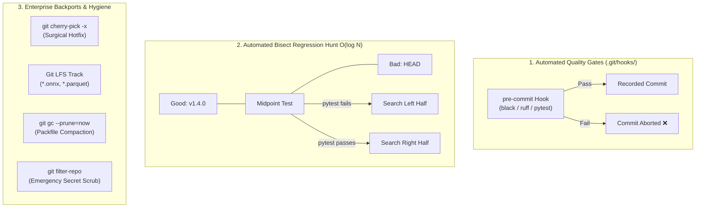

# 🚀 Level 5: Industrial Git, Automated Bisect, Hooks & Monorepos

Welcome to **Level 5 of the Git Zero-to-Hero Masterclass**. This capstone level trains engineers in elite DevOps and industrial engineering practices: surgically backporting hotfixes with `cherry-pick`, pinpointing bugs automatically across thousands of commits in $O(\log N)$ with autonomous `git bisect`, building automated quality gates with client-side Git hooks, handling binary weights with Git LFS and submodules, compacting repository databases, and scrubbing leaked credentials from Git history.



---

## 🍒 Lesson 5.1 — Surgical Backports with Cherry-Pick

### 1. What is Cherry-Picking?
In production software engineering, you often fix a critical security vulnerability on a cutting-edge `develop` or feature branch that contains dozens of unreleased or untested features. You cannot merge `develop` into `main` because untested code would leak into production.

`git cherry-pick` extracts the exact diff patch introduced by a single commit and applies it cleanly on top of your current branch as a new commit with a new SHA hash.

### 2. Surgical Hotfix Backport Workflow
```bash
# 1. Switch to production main branch
git switch main

# 2. Apply specific bugfix commit onto main
git cherry-pick 8f1e29c

# 3. Best Practice: Append origin commit reference to commit message
git cherry-pick -x 8f1e29c
# Generates message footnote: '(cherry picked from commit 8f1e29c3d4e8...)'

# 4. Cherry-pick a range of commits sequentially
git cherry-pick 32f8190..8f1e29c

# 5. If conflict arises during cherry-pick:
# Resolve files, stage with 'git add <file>', then:
git cherry-pick --continue
# Or abort anytime:
git cherry-pick --abort
```

---

## 🔍 Lesson 5.2 — Automated Regression Hunting with Git Bisect

### 1. The $O(\log N)$ Binary Search Engine
When a regression or performance defect is discovered in production, manually testing hundreds of commits to find where it was introduced is exhausting.

`git bisect` uses binary search to pinpoint the breaking commit. Even in a repository with **1,000 commits**, `git bisect` finds the exact bug in only **10 steps** ($\log_2(1000) \approx 10$).

### 2. Manual Bisect Walkthrough
```bash
# 1. Start bisect mode
git bisect start

# 2. Tell Git the current commit has the bug
git bisect bad

# 3. Tell Git a historical commit or release tag where everything worked
git bisect good v1.4.0

# 4. Git automatically checks out the exact middle commit:
# Bisecting: 64 revisions left to test after this (roughly 6 steps)
# [8f1e29c3d4e821b] feat(auth): add token expiry

# 5. Test your application. If bug exists:
git bisect bad
# If bug does not exist:
git bisect good

# 6. Once Git reveals the culprit commit, return HEAD to initial branch
git bisect reset
```

### 3. Fully Autonomous Bisecting with Test Scripts
Instead of manually running tests at every midpoint, give Git an automated test command (e.g. `pytest`). Git will run the test autonomously, evaluate the exit code (`0` = good, `!= 0` = bad), and pinpoint the culprit in seconds:

```bash
# 1. Define bad and good boundaries
git bisect start HEAD v1.4.0

# 2. Hand off full control to your test suite
git bisect run pytest tests/test_payment.py
```
Git will output:
```text
8f1e29c3d4e821b9a5101eb658d8af03e9c08fb is the first bad commit
Author: Alex Morgan <engineer@teachcloud.dev>
Date:   Mon Oct 19 14:10:00 2026 +0100
    fix(payment): alter stripe currency multiplier
```

---

## ⚙️ Lesson 5.3 — Automated Quality Gates with Git Hooks

### 1. Client-Side Git Hooks Architecture
Git hooks are executable scripts located in `.git/hooks/` that run automatically before or after key Git lifecycle events.

| Hook Name | Lifecycle Trigger | Can Abort Operation? | Primary Use Case |
| :--- | :--- | :---: | :--- |
| **`pre-commit`** | Runs before commit message is entered | ✅ Yes (`exit 1`) | Linting (Ruff/Black), type checking (Mypy), fast unit tests |
| **`commit-msg`** | Runs after user writes commit message | ✅ Yes (`exit 1`) | Enforcing Conventional Commits format (`feat:`, `fix:`) |
| **`pre-push`** | Runs before network transmission to remote | ✅ Yes (`exit 1`) | Full test suite execution, secret scanning (TruffleHog) |

### 2. Creating an Automated `.git/hooks/pre-commit` Script
Create executable file `.git/hooks/pre-commit`:

```bash
#!/bin/sh
echo "🔍 Running automated pre-commit quality gate..."

# 1. Run short unit test suite
pytest --tb=short -q
if [ $? -ne 0 ]; then
    echo "❌ Unit tests failed. Commit aborted."
    exit 1
fi

echo "✅ All pre-commit checks passed. Proceeding with commit."
exit 0
```

Make it executable:
```bash
chmod +x .git/hooks/pre-commit
```

---

## 📦 Lesson 5.4 — Large File Storage (Git LFS) & Submodules

### 1. Git LFS (Large File Storage)
Storing large binary files (PyTorch `.onnx` models, Parquet datasets, video renders) directly in Git causes repository bloat because every version is stored permanently in `.git/objects`.

**Git LFS** replaces large files with tiny 130-byte text pointer files containing SHA-256 hashes, while the actual binaries are stored on scalable cloud storage (S3/GCS):

```bash
# 1. Initialize Git LFS on local system
git lfs install

# 2. Track large file patterns
git lfs track "*.onnx" "*.parquet" "*.mp4"

# 3. Crucial: Stage the generated .gitattributes file
git add .gitattributes
git commit -m "chore(lfs): track binary models and datasets"
```

### 2. Managing Nested Monorepo Dependencies with Git Submodules
Git submodules allow you to keep another Git repository as a subdirectory of your repository, locked to a specific commit SHA:

```bash
# 1. Add external dependency as a submodule
git submodule add https://github.com/teachcloud/sdk.git vendor/sdk

# 2. Clone repository containing submodules and fetch nested trees
git clone --recurse-submodules https://github.com/teachcloud/cloud_flask.git

# 3. Pull updates for all submodules in existing repo
git submodule update --init --recursive
```

---

## 🧹 Lesson 5.5 — Repository Hygiene & Secret Scrubbing

### 1. Cleaning Untracked Files and Build Artifacts
Clean unwanted build artifacts, temporary cache files, and logs:

```bash
# 1. Dry run: list files that would be deleted without actually deleting
git clean -nd

# 2. Force removal of untracked files and directories
git clean -fd

# 3. Force removal including files ignored by .gitignore
git clean -fdx
```

### 2. Compacting the Git Object Database
Over time, loose object files accumulate. Use `git gc` to pack loose objects into compressed packfiles and prune unreachable dangling commits:

```bash
# Deep compaction and immediate pruning
git gc --prune=now --aggressive
```

### 3. Emergency Secret Scrubbing with `git-filter-repo`
> [!CAUTION]
> If a developer accidentally commits `.env`, AWS credentials, or database passwords, simply deleting the file in a new commit **does NOT remove it from Git history**! Attackers can still extract it from older commit trees.

Use `git-filter-repo` (the modern, official replacement for deprecated `git filter-branch`):

```bash
# 1. Install git-filter-repo
pip install git-filter-repo

# 2. Scrub .env from every commit, branch, and tag in entire repository history
git filter-repo --path .env --invert-paths

# 3. Force push cleaned history to remote (requires administrator force-push privileges)
git push origin --force --all
git push origin --force --tags
```

---

## 📝 Level 5 Summary & Key Takeaways

1. **Cherry-Pick for Surgical Fixes**: Backport bugfixes directly to production with `git cherry-pick -x`.
2. **Bisect Saves Days of Debugging**: Let `git bisect run pytest` find regressions automatically in $O(\log N)$.
3. **Automate Quality Gates**: Guard code quality locally using `.git/hooks/pre-commit`.
4. **Use LFS for Binaries**: Prevent repo bloat by storing weights and media with `git lfs`.
5. **Hygiene & Security**: Keep repositories compact with `git gc`, and purge leaked credentials permanently with `git-filter-repo`.
