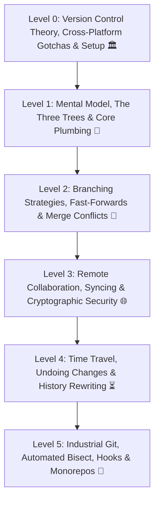

# 🐙 Git Zero-to-Hero Masterclass Curriculum

Welcome to the comprehensive **Git & Version Control from Zero to Hero** engineering curriculum for TeachCloud. This multi-level curriculum takes software engineers and DevOps practitioners from basic command line commits to advanced branch orchestration, surgical conflict resolution, interactive rebase time-travel, and automated CI/CD hook integrations.



---

## 🗺️ Curriculum Blueprint & Tier Architecture

| Level | Designation | Core Competencies | Primary Commands & Concepts | Real-World Production Context |
| :--- | :--- | :--- | :--- | :--- |
| **Level 0** | **Version Control Theory & Cross-Platform Setup** | Centralized vs Distributed VCS, snapshot model, CRLF/LF line endings, case sensitivity, SSH authentication | `core.autocrlf`, `core.longpaths`, `ssh-keygen -t ed25519`, `git config --list --show-origin`, package managers (`apt`, `winget`, `brew`) | Preventing cross-platform line ending corruption (`^M`), configuring team identity, cryptographic SSH authentication. |
| **Level 1** | **Git Core Mental Model & Everyday Plumbing** | Distributed VCS model, the Three Trees (Working Dir, Index, Repository), tracking changes, atomic commits | `git init`, `git clone`, `git config`, `git status -s`, `git add -p`, `git commit -m`, `git diff --staged`, `git log --oneline --graph` | Initializing codebases, authoring atomic commits, staging partial hunks, configuring team conventions. |
| **Level 2** | **Branching Strategies, Merging & Conflict Resolution** | Pointer mechanics (`HEAD`, branch refs), Fast-Forward vs True Merges, 3-way merge resolution, branching workflows | `git branch -a`, `git switch -c`, `git merge --no-ff`, `git merge --abort`, `<<<<<<< HEAD`, GitFlow, Trunk-Based Development | Managing feature workflows, releasing hotfixes without code regressions, resolving conflicting team edits. |
| **Level 3** | **Remote Collaboration, Syncing & Cryptographic Auth** | Remote tracking branches (`origin`), Fetch vs Pull, upstream tracking, SSH keys, GPG commit signing | `git remote -v`, `git fetch --prune`, `git pull --rebase`, `git push --force-with-lease`, `git branch -vv`, SSH Ed25519, GPG keys | Pull Request (PR) peer reviews, keeping local branches up to date, immutable cryptographic supply-chain security. |
| **Level 4** | **Time Travel, Undoing Changes & History Rewriting** | Safe un-staging, reset modes (Soft, Mixed, Hard), non-destructive revert, stash shelving, interactive rebasing, Reflog | `git restore`, `git reset --soft/--hard`, `git revert`, `git stash pop`, `git rebase -i HEAD~N`, `git reflog` | Scrubbing temporary commits before PR merge, salvaging accidentally deleted branches, non-destructive rollbacks. |
| **Level 5** | **Industrial Git, Automated Bisect, Hooks & Monorepos** | Binary search regression debugging (`bisect`), surgical commit backports (`cherry-pick`), client/server hooks, Git LFS | `git cherry-pick -x`, `git bisect start/bad/good/run`, `.git/hooks/pre-commit`, `git clean -fd`, `git lfs`, `git submodule` | Pinpointing which commit broke production in seconds, enforcing automated linting/tests prior to commit, handling gigabyte assets. |

---

## 📚 Detailed Syllabus Breakdown

### Level 0: Version Control Theory, Cross-Platform Architecture & Setup 🏛️
*Documentation: [`docs/Git/LEVEL_0_GIT_FOUNDATIONS_AND_INSTALLATION.md`](LEVEL_0_GIT_FOUNDATIONS_AND_INSTALLATION.md)*

* **Lesson 0.1 — Version Control Paradigms: Centralized vs. Distributed**
  * Centralized VCS (SVN, Perforce): Single point of failure, network dependency.
  * Distributed VCS (Git): Full-fidelity local clone, offline speed, resilient team backup.
  * Storage mechanics: File diff deltas vs Git's immutable DAG of filesystem snapshots.
* **Lesson 0.2 — Cross-Platform Operating System Gotchas (Windows vs. macOS vs. Linux)**
  * **Line Endings**: Windows CRLF (`\r\n`) vs Unix/Linux/macOS LF (`\n`). Broken bash scripts (`^M: command not found`), `core.autocrlf` rules, and `.gitattributes`.
  * **Filename Case Sensitivity**: Linux ext4 case-sensitive (`App.py` != `app.py`) vs Windows/macOS case-preserving case-insensitive.
  * **POSIX Filemode (`+x`)**: Windows missing executable bits; preserving script execution with `git update-index --chmod=+x`.
  * **File Path Lengths**: Windows 260-character `MAX_PATH` vs Linux 4096-character paths (`core.longpaths true`).
  * **Symlinks & Credentials**: Windows Credential Manager (`wincred`) vs macOS Keychain (`osxkeychain`) vs Linux SSH Agent.
* **Lesson 0.3 — Step-by-Step Installation Across Platforms**
  * **Linux**: `sudo apt install git` (Ubuntu/Debian) or `sudo dnf install git` (Fedora/RHEL).
  * **Windows**: `winget install --id Git.Git` or Git for Windows installer with Git Bash.
  * **macOS**: `xcode-select --install` or `brew install git`.
* **Lesson 0.4 — Mandatory First-Time Global Configuration**
  * Developer identity: `git config --global user.name` and `user.email`.
  * Industry standard branch: `git config --global init.defaultBranch main`.
  * Line ending auto-conversion: `core.autocrlf true` (Windows) / `input` (Mac/Linux).
  * Pull rebase strategy: `git config --global pull.rebase true`.
* **Lesson 0.5 — Cryptographic SSH Authentication**
  * Generating Ed25519 elliptic-curve keys: `ssh-keygen -t ed25519 -C "email"`.
  * Registering public key on GitHub/GitLab and validating handshake (`ssh -T git@github.com`).

---

### Level 1: Git Core Mental Model & Everyday Plumbing 🎯
*Documentation: [`docs/Git/LEVEL_1_CORE_PLUMBING.md`](LEVEL_1_CORE_PLUMBING.md)*
*Target Milestone: Establishing foundational understanding of Git's directed acyclic graph (DAG) and mastering the 3-state workflow.*

* **Lesson 1.1 — The Git Architecture & Mental Model**
  * Distributed VCS vs Centralized VCS (SVN/Perforce).
  * The Content-Addressable Storage Engine: Blobs, Trees, Commits, and Annotated Tags.
  * SHA-1 & SHA-256 cryptographic hashes: Why Git is an append-only directed acyclic graph (DAG).
  * Global and local configuration:
    ```bash
    git config --global user.name "Cloud Engineer"
    git config --global user.email "engineer@teachcloud.dev"
    git config --global init.defaultBranch main
    git config --global core.editor "nano"
    git config --global core.autocrlf input
    git config --list --show-origin
    ```
* **Lesson 1.2 — The Three Trees of Git**
  * **Working Directory**: The actual files on your filesystem that you edit.
  * **Staging Area (Index)**: The preparation snapshot of what will be committed next.
  * **Git Repository (`.git/`)**: The permanent commit history database.
  * Inspecting repository health and status:
    ```bash
    git init my-app
    git status -s        # Short format: '??' untracked, 'M ' staged, ' M' modified
    ```
* **Lesson 1.3 — Staging, Hunks & Atomic Commits**
  * Staging strategies:
    ```bash
    git add file.py            # Stage single file
    git add .                  # Stage all changes in directory
    git add -p                 # Interactive patch mode: stage individual hunks (y/n/s/e)
    ```
  * Writing high-quality, atomic commit messages (Conventional Commits: `feat:`, `fix:`, `docs:`, `chore:`):
    ```bash
    git commit -m "feat(auth): implement argon2 password hashing"
    git commit --amend         # Modify the most recent commit message or add staged files
    ```
  * Excluding files with `.gitignore`: Wildcards (`*.log`), directory patterns (`node_modules/`, `.venv/`), exception rules (`!important.log`).
* **Lesson 1.4 — Inspecting History & Code Differences**
  * Navigating history cleanly:
    ```bash
    git log --oneline -n 10
    git log --graph --oneline --decorate --all
    git log -p -2              # Show diff patch for last 2 commits
    git log --author="Alex" --since="2 weeks ago"
    ```
  * Comparing differences:
    ```bash
    git diff                   # Working Directory vs Staging Area
    git diff --staged          # Staging Area vs Last Commit (HEAD)
    git show <commit-hash>     # Inspect metadata and diff of specific commit
    ```

---

### Level 2: Branching Strategies, Merging & Conflict Resolution 🌿
*Target Milestone: Fluid branch switching, mastering fast-forward vs merge commits, and fearlessly resolving complex merge conflicts.*

* **Lesson 2.1 — Branch Mechanics & Pointer Architecture**
  * What is a branch? A movable 41-byte pointer referencing a commit hash.
  * The `HEAD` pointer: Tracking the currently checked-out branch or commit.
  * Managing branches:
    ```bash
    git branch                 # List local branches
    git branch -a              # List local and remote tracking branches
    git branch feature-auth    # Create branch without switching
    git switch feature-auth    # Modern branch switching (replaces legacy checkout)
    git switch -c feature-api  # Create and switch in one step (equivalent to checkout -b)
    git branch -d feature-api  # Safe delete (checks if merged)
    git branch -D feature-api  # Force delete unmerged branch
    ```
* **Lesson 2.2 — Fast-Forward vs True Merge Commits**
  * **Fast-Forward Merge (`--ff-only`)**: Moves branch pointer forward without creating a merge commit when history is linear.
  * **3-Way Merge (`--no-ff`)**: Combines diverged branches with a common ancestor, producing a true merge commit:
    ```bash
    git switch main
    git merge feature-auth --no-ff -m "merge: integrate feature-auth"
    ```
  * Linear history preservation with Fast-Forward enforcement:
    ```bash
    git merge --ff-only feature-payment
    ```
* **Lesson 2.3 — Anatomical Merge Conflict Resolution**
  * What causes conflicts: Concurrent edits to identical lines across diverged commits.
  * Conflict markers breakdown:
    ```diff
    <<<<<<< HEAD
    DATABASE_URL = "postgresql://prod-db:5432/teachcloud"
    =======
    DATABASE_URL = "postgresql://cluster-primary:5432/teachcloud"
    >>>>>>> feature/database-refactor
    ```
  * Resolution workflow:
    1. Inspect conflicts with `git status`.
    2. Edit files to remove markers and choose desired production logic.
    3. Stage resolved files with `git add <file>`.
    4. Conclude merge with `git merge --continue` (or abort anytime with `git merge --abort`).
* **Lesson 2.4 — Production Team Branching Models**
  * **Trunk-Based Development**: Short-lived feature branches, frequent merges to `main`, feature flags.
  * **GitHub Flow**: `main` is always deployable; feature branches open Pull Requests (PRs).
  * **GitFlow**: `main` (production), `develop` (staging), `feature/*`, `release/*`, `hotfix/*`.

---

### Level 3: Remote Collaboration, Syncing & Cryptographic Auth 🌐
*Target Milestone: Seamless synchronization with GitHub/GitLab/AWS CodeCommit, understanding tracking branches, and cryptographic commit signing.*

* **Lesson 3.1 — Remotes Architecture & Linkage**
  * What is a remote? Named shorthand URL referencing a central repository.
  * Commands:
    ```bash
    git remote -v
    git remote add origin git@github.com:teachcloud/cloud_flask.git
    git remote rename origin upstream
    git remote remove old-remote
    ```
* **Lesson 3.2 — Fetching vs Pulling & Branch Tracking**
  * **`git fetch`**: Downloads remote commits, branches, and tags into local repository WITHOUT modifying your working files. Remote tracking branches live at `origin/main`.
  * **`git pull`**: `git fetch` followed immediately by `git merge`.
  * Rebase-pull strategy (preventing unnecessary merge bubbles):
    ```bash
    git pull --rebase origin main
    git config --global pull.rebase true
    ```
  * Pruning stale branches deleted by teammates on the remote:
    ```bash
    git fetch --prune origin
    ```
* **Lesson 3.3 — Pushing & Tracking Branches**
  * Setting upstream tracking:
    ```bash
    git push -u origin feature-billing     # -u links local branch to origin/feature-billing
    git branch -vv                          # Inspect tracking relationships and ahead/behind counts
    ```
  * Safe force-pushing (Preventing team destruction):
    ```bash
    # NEVER use: git push --force (destroys teammates' commits!)
    # ALWAYS use:
    git push --force-with-lease origin feature-billing
    ```
  * Deleting remote branches:
    ```bash
    git push origin --delete feature-billing
    ```
* **Lesson 3.4 — Cryptographic Authentication & Commit Signing**
  * SSH Key generation and authentication:
    ```bash
    ssh-keygen -t ed25519 -C "dev@teachcloud.dev"
    cat ~/.ssh/id_ed25519.pub
    ssh -T git@github.com
    ```
  * Verified commits using GPG or SSH signing:
    ```bash
    git config --global user.signingkey ~/.ssh/id_ed25519.pub
    git config --global gpg.format ssh
    git config --global commit.gpgsign true
    git log --show-signature -n 1
    ```

---

### Level 4: Time Travel, Undoing Changes & History Rewriting ⏳
*Target Milestone: Total command over non-destructive reverts, reset mechanics, branch resurrection with Reflog, and interactive rebasing.*

* **Lesson 4.1 — Restoring Files (Working Directory & Staging)**
  * Modern restoration with `git restore`:
    ```bash
    git restore main.py                 # Discard uncommitted edits in working directory
    git restore --staged main.py        # Unstage file (moves from index back to working dir)
    git restore --source=HEAD~2 main.py # Restore file as it was 2 commits ago
    ```
* **Lesson 4.2 — Git Reset: Soft vs Mixed vs Hard**
  * Understanding the 3 reset tiers:
    * `--soft`: Moves `HEAD` pointer only. Changes stay staged in Index. (Perfect for combining last 3 commits).
      ```bash
      git reset --soft HEAD~3
      git commit -m "feat: consolidated feature implementation"
      ```
    * `--mixed` (default): Moves `HEAD` pointer and clears Staging Area. Changes remain in Working Directory.
      ```bash
      git reset HEAD~1
      ```
    * `--hard`: Moves `HEAD`, clears Index, and OVERWRITES Working Directory to target commit.
      ```bash
      git reset --hard HEAD~1    # Destructive for uncommitted work!
      ```
* **Lesson 4.3 — Non-Destructive Rollbacks with Revert**
  * Why `revert` is mandatory for public/shared branches: Creates an inverse commit that cancels previous code changes without rewriting history.
    ```bash
    git revert <bad-commit-hash>
    git revert -n <hash1> <hash2>       # Revert multiple commits without auto-committing
    ```
* **Lesson 4.4 — Temporary Shelving with Git Stash**
  * Clean context switching:
    ```bash
    git stash push -m "WIP: payment integration"
    git stash list
    git stash show -p stash@{0}
    git stash pop                       # Apply and remove from stash stack
    git stash apply                     # Apply while keeping stash entry
    git stash drop stash@{0}            # Delete specific stash
    git stash clear                     # Purge all stashes
    ```
* **Lesson 4.5 — Interactive Rebasing (`rebase -i`)**
  * Sculpting a clean pull request history:
    ```bash
    git rebase -i HEAD~4
    ```
  * Rebase action commands:
    * `pick`: Keep commit as-is.
    * `reword`: Change commit message.
    * `edit`: Pause rebase to amend files.
    * `squash`: Meld commit into previous commit with combined message.
    * `fixup`: Meld commit into previous commit discarding current commit message.
    * `drop`: Remove commit entirely.
* **Lesson 4.6 — The Ultimate Safety Net: The Git Reflog**
  * The Reference Log (`reflog`): Local journal recording every movement of `HEAD` (commits, resets, rebases, checkouts).
  * Recovering accidentally deleted branches or hard-reset commits:
    ```bash
    git reflog                          # Find commit hash right before catastrophic reset
    git switch -c recovered-branch HEAD@{3}
    ```

---

### Level 5: Industrial Git, Automated Bisect, Hooks & Monorepos 🚀
*Target Milestone: Production DevOps workflows, automated regression hunting, automated commit linting, and high-performance repository hygiene.*

* **Lesson 5.1 — Surgical Backports with Cherry-Pick**
  * Copying specific bugfixes from `develop` into `main` without merging all intervening features:
    ```bash
    git switch main
    git cherry-pick <commit-hash>
    git cherry-pick -x <commit-hash>    # Appends '(cherry picked from commit ...)' reference
    ```
* **Lesson 5.2 — Automated Regression Hunting with Git Bisect**
  * Finding the exact commit that introduced a production regression using binary search ($O(\log N)$):
    ```bash
    git bisect start
    git bisect bad                      # Current commit is broken
    git bisect good v1.4.0              # Known working release
    # Git automatically checks out midpoint
    git bisect good (or git bisect bad)
    git bisect reset                    # Return to initial state
    ```
  * **Fully Autonomous Bisecting**:
    ```bash
    git bisect start HEAD v1.4.0
    git bisect run pytest tests/test_payment.py   # Pinpoints bug commit in seconds!
    ```
* **Lesson 5.3 — Automated Quality Gates with Git Hooks**
  * Client-side hooks located in `.git/hooks/`:
    * `pre-commit`: Run formatters (`black`, `flake8`), linters, and unit tests before allowing commit.
    * `commit-msg`: Enforce conventional commit regex formats (`^(feat|fix|docs|chore): `).
  * Writing an automated `.git/hooks/pre-commit` script:
    ```bash
    #!/bin/sh
    echo "Running automated pre-commit test suite..."
    pytest --tb=short -q
    if [ $? -ne 0 ]; then
        echo "❌ Pre-commit validation failed. Aborting commit."
        exit 1
    fi
    ```
* **Lesson 5.4 — Large File Storage (Git LFS) & Submodules**
  * Handling machine learning models, database dumps, and media without repository bloat:
    ```bash
    git lfs install
    git lfs track "*.onnx" "*.parquet"
    git add .gitattributes
    ```
  * Managing nested dependencies with Git Submodules:
    ```bash
    git submodule add https://github.com/teachcloud/sdk.git vendor/sdk
    git submodule update --init --recursive
    ```
* **Lesson 5.5 — Repository Hygiene & Secret Scrubbing**
  * Cleaning untracked files:
    ```bash
    git clean -nd                       # Dry-run
    git clean -fd                       # Force removal of untracked files and directories
    ```
  * Compacting repository database:
    ```bash
    git gc --prune=now --aggressive
    ```
  * Emergency response: Scrubbing leaked API keys and `.env` credentials from all git history:
    ```bash
    git filter-repo --path .env --invert-paths
    ```

---

## 🛠️ Complete Git Command Quick Reference

| Action | Primary Command | Essential Flags |
| :--- | :--- | :--- |
| **Inspect Status** | `git status` | `-s` (short format), `-b` (show branch) |
| **Stage Hunk** | `git add` | `-p` (interactive patch), `-u` (tracked only) |
| **Commit Staged** | `git commit` | `-m "msg"`, `--amend` (amend last commit) |
| **Inspect History** | `git log` | `--oneline --graph --decorate --all -n 20` |
| **Compare Changes** | `git diff` | `--staged` (compare index with HEAD) |
| **Switch / Create Branch** | `git switch` | `-c <name>` (create & switch), `-` (switch back) |
| **Merge Feature** | `git merge` | `--no-ff` (true merge), `--abort` (cancel) |
| **Sync Remote** | `git pull` | `--rebase` (linear history), `--prune` |
| **Safe Force Push** | `git push` | `--force-with-lease origin <branch>` |
| **Shelve Edits** | `git stash` | `push -m "tag"`, `pop`, `list`, `drop` |
| **Undo Commit (Safe)** | `git revert` | `<hash>`, `-n` (no auto commit) |
| **Undo Commit (Local)** | `git reset` | `--soft HEAD~1`, `--hard HEAD~1` |
| **Recover Lost Commits** | `git reflog` | `git switch -c recovered HEAD@{N}` |
| **Binary Search Bug** | `git bisect` | `start`, `bad`, `good`, `run <script>` |
| **Surgical Backport** | `git cherry-pick` | `<hash>`, `-x` (source reference) |
